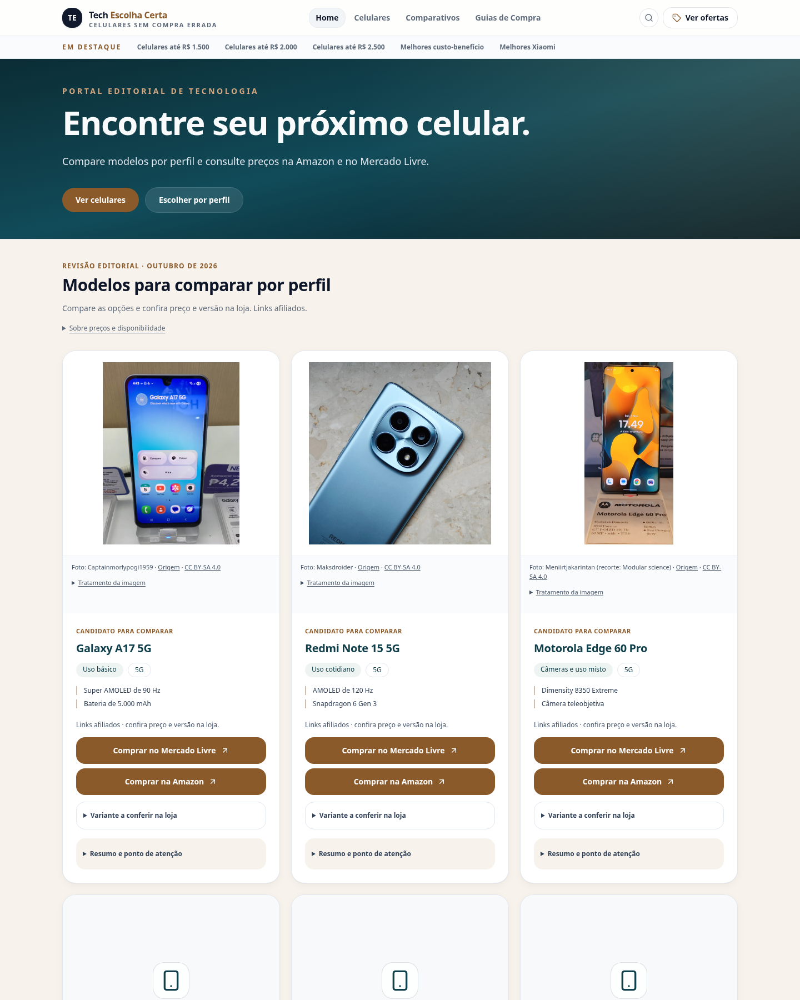
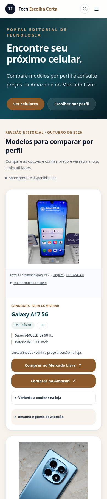
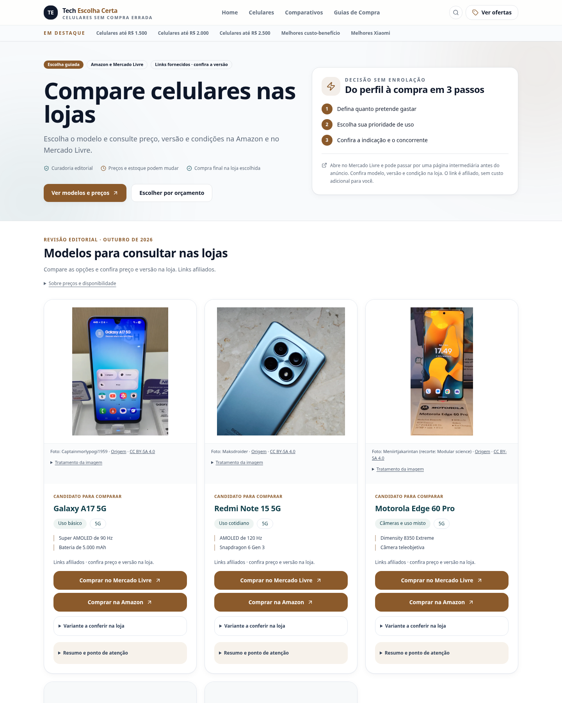
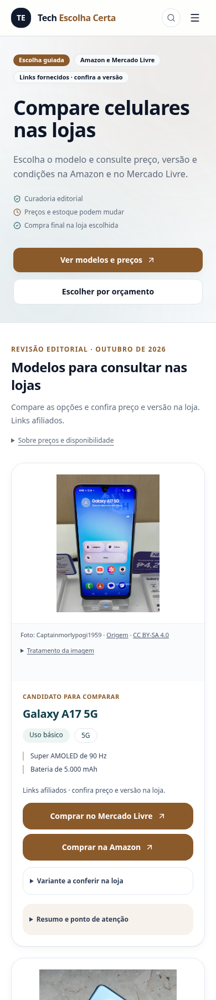

# Apresentação de catálogo para aprovação

**Nenhum celular recebeu imagem oficial nova:** a pesquisa não encontrou autorização aplicável comprovada. [Fontes, decisões por aparelho e limitações](fontes-e-permissoes.md).

Foram mantidas as quatro fotos Commons licenciadas, os placeholders e os 26 links originais. A apresentação compartilhada agora usa fundo branco, área de imagem consistente e `object-fit: contain`, sem distorcer ou cortar o aparelho. Autoria, fonte e CC BY-SA 4.0 ficam visíveis; as alterações já documentadas podem ser expandidas em “Tratamento da imagem”. Isso melhora a organização, mas não transforma as fotos atuais em fotografias de estúdio.

A alteração alcança os componentes usados em home, cards, rankings, ofertas, guias e comparativos; páginas sem foto aprovada continuam exibindo placeholder. Metadados SEO e dados do catálogo permanecem inalterados.

| Página | Desktop 1440 px | Celular 390 px |
| --- | --- | --- |
| Home | [Captura](home-desktop.png) | [Captura](home-mobile.png) |
| Ofertas | [Captura](ofertas-desktop.png) | [Captura](ofertas-mobile.png) |
| Ranking | [Captura](ranking-desktop.png) | [Captura](ranking-mobile.png) |

### Home desktop

### Home celular

### Ofertas desktop

### Ofertas celular

Arquivos `*-completa.jpg` mostram as páginas inteiras. As capturas foram geradas na aplicação local, sem publicação.

## Testes concluídos

33 testes aprovados (28 Node e 5 Python), TypeScript e build aprovados; lint sem erros e com seis avisos preexistentes de Fast Refresh. A build mantém aviso de bundle acima de 500 kB.

Regressão em 47 caminhos (incluindo inexistente), 56 layouts de 360, 390, 768 e 1440 px; nenhuma falha. Axe em cinco páginas representativas sem violações detectadas no escopo automatizado. Carregamento das quatro fotos em 58 ocorrências e fallback de cada modelo aprovados. Os seis layouts capturados passaram por 64 cliques simulados com destino e evento conferidos, sem tráfego às lojas. Não foi consultado preço ou estoque real.

46 rotas registradas, 374 referências internas e 37 URLs no sitemap sem links internos quebrados. Os 26 destinos originais de afiliados foram conferidos pelos testes; `src/lib`, assets, sitemap, robots e workflows não têm alterações em relação ao commit de base.

[Resumo estruturado da verificação](verificacao.json). Nenhuma publicação, merge, PR ou alteração de produção foi realizada. A obtenção de imagens pelo Actions não foi necessária por não haver novo arquivo aprovado; a consulta de workflows também encontrou bloqueio `Forbidden`, registrado na pesquisa.
