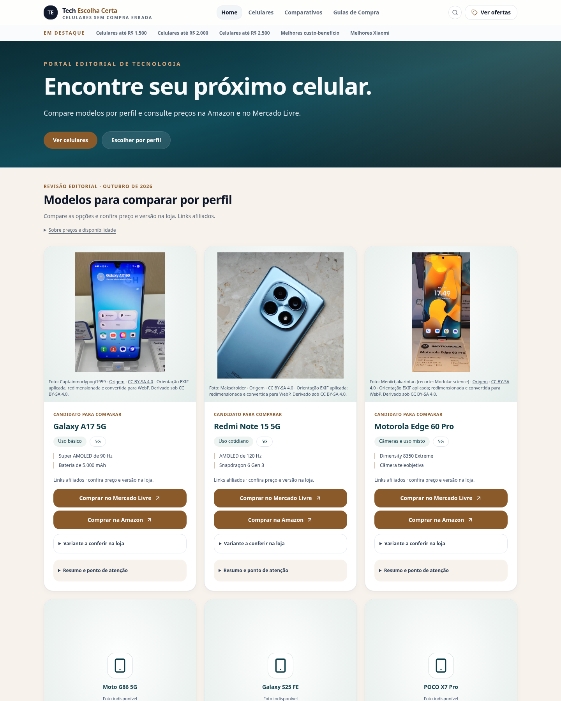
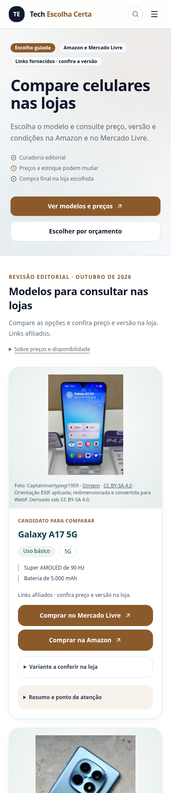

# Revisão visual para aprovação — 19/10/2026

Branch: `codex/vitrine-fotos-reais-2026-10-19`. Nenhuma publicação, PR ou merge faz parte desta revisão.

## Prévia navegável sem publicação

[Baixar a prévia ZIP](previa-offline.zip). Extraia os arquivos e abra `index.html`. Se seu navegador bloquear arquivos locais, execute `python -m http.server 8080` dentro da pasta extraída e visite `http://localhost:8080`. Não é necessário acesso à internet para navegar pelas 46 páginas, CSS e fotografias incluídas.

É uma captura estática da aplicação: navegação, fotos e detalhes expansíveis estão disponíveis; busca e seletor interativo de produtos dependem da aplicação completa. Os botões de compra mostram seu destino em uma mensagem, sem acessar lojas ou enviar analytics. A aplicação completa foi testada separadamente. Não há endereço público de hospedagem desta prévia.

## Capturas desktop e celular

Capturas em 1440 × 1800 e 390 × 1800; arquivos `*-completa.jpg` mostram a página inteira.

| Página | Desktop | Celular |
| --- | --- | --- |
| Home `/` | [Abrir](home-desktop.png) | [Abrir](home-mobile.png) |
| Ofertas `/ofertas` | [Abrir](ofertas-desktop.png) | [Abrir](ofertas-mobile.png) |
| Ranking `/melhores-celulares-custo-beneficio` | [Abrir](ranking-desktop.png) | [Abrir](ranking-mobile.png) |

### Home

### Ofertas

### Ranking principal

## Ajustes realizados

- Home com chamada mais direta, menos texto inicial e atalhos para os celulares e escolha por perfil.
- Ofertas apresenta primeiro a seleção atual com fotos e opções de compra, antes dos cards legados.
- Ranking principal aponta o CTA para a seleção atual, corrigindo o destino anterior.
- Cards priorizam aparelhos com duas lojas e, em igualdade de condições, foto aprovada. Fotos maiores, duas características essenciais e botões de pelo menos 48 px; variante, análise detalhada e avisos continuam disponíveis em áreas expansíveis.
- Créditos e licenças continuam visíveis. Os avisos de afiliação e conferência de preço/versão permanecem junto aos botões; FAQ, metadados, canonicals e conteúdo editorial permanecem no HTML.
- Pendências anteriores de formatação corrigidas em commit separado, sem alteração de comportamento.

Em celular de 390 px, a primeira opção de compra da seleção atual em ofertas passou de 4.574,5 px para 1.372,5 px de distância do topo (70% menos rolagem). Isso mede acesso ao botão, não aumento comprovado de conversão. Ainda há conteúdo editorial longo abaixo da vitrine, preservado para leitura e SEO.

## Fotos e páginas verificadas

**4 modelos com fotografias licenciadas funcionando:** Galaxy A17 5G, Galaxy A36 5G, Redmi Note 15 5G e Motorola Edge 60 Pro. Foram verificadas 58 ocorrências de modelo/página/viewport, incluindo decodificação real e fallback em falha. Moto G56 5G, Moto G86 5G e Galaxy S25 FE continuam com placeholders identificados; não foram adicionadas fotos sem autorização.

Rotas com fotos verificadas em 390 e 1440 px: `/`, `/celulares`, `/ofertas`, `/melhores-celulares-custo-beneficio`, `/melhores-celulares-ate-2000`, `/melhores-celulares-ate-2500`, `/melhores-celulares-samsung`, `/melhores-celulares-xiaomi`, `/melhores-celulares-xiaomi-custo-beneficio`, `/guia/melhores-celulares-ate-1500-reais`, `/guia/melhores-celulares-ate-2000-reais`, `/guia/melhores-celulares-ate-3000-reais` e `/guia/melhores-celulares-para-jogos-ate-2000`. Cada página foi conferida para os modelos nela presentes.

## Validação

- 33 testes automatizados aprovados (28 Node e 5 Python).
- TypeScript e build de produção aprovados. A build mantém aviso de tamanho de bundle acima de 500 kB, sem impedir a geração.
- Lint completo sem erros; 6 avisos preexistentes de Fast Refresh.
- 46 rotas registradas, 374 referências internas e 37 URLs de sitemap: nenhum link interno quebrado.
- Regressão de navegador: 47 caminhos, incluindo página inexistente; 56 layouts; nenhum erro. Axe em home, ofertas, ranking, review e comparativo: nenhuma violação detectada no escopo automatizado.
- Teste adicional dos seis layouts capturados: sem transbordamento horizontal, H1/canonical presentes, fotos decodificadas; 64 cliques simulados com destino e evento conferidos. Nenhuma requisição enviada às lojas.
- 26 URLs de afiliados originais preservadas, com integridade do catálogo conferida; preços e estoque nas lojas não foram consultados.
- ZIP extraído e testado em servidor local: 46 páginas, integridade SHA-256, CSS, fotos, navegação entre páginas e bloqueio de saída para afiliados aprovados; nenhuma requisição externa ou erro JavaScript. A política administrativa deste ambiente bloqueia `file://`, por isso o teste usou HTTP local, sem contornar a restrição.

Scripts reproduzíveis: `scripts/final-visual-review.py`, `scripts/export-review-preview.py`, `scripts/offline-preview-smoke.py`, além dos scripts existentes de regressão visual e fotos licenciadas. As capturas correspondem aos ajustes funcionais; o commit de formatação não altera o resultado visual.
