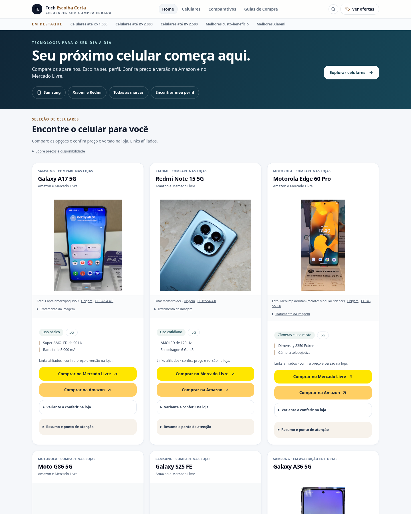
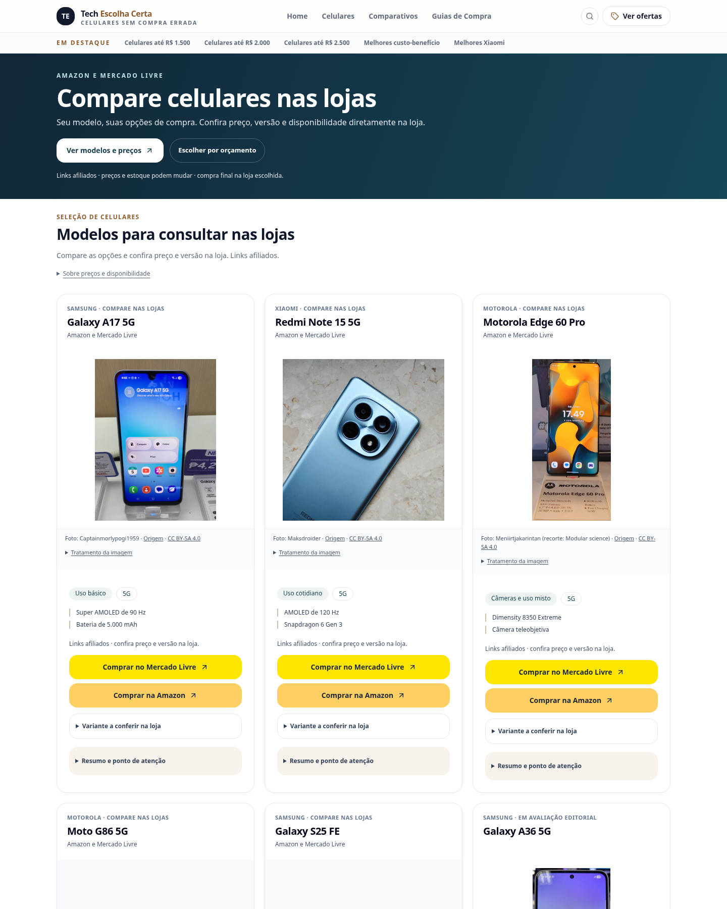

# Revisão visual das nove imagens e situação da vitrine

Revisão de 19/10/2026, a partir de `2467ea1adf99736f17880a470165c8e0b65deaf2`, na branch `codex/vitrine-fotos-reais-2026-10-19`.

**Resultado: 4 dos 7 modelos continuam com imagens autorizadas funcionando. Nenhum dos três novos renders foi ativado.** As nove imagens foram efetivamente acessadas e revisadas, mas não foi comprovada permissão compatível com a vitrine comercial para os arquivos escolhidos.

## Acesso e integridade

ZIP baixado pelo conector oficial GitHub Actions: execução [39298422708](https://github.com/rgarcia2903/tech-escolha-certa/actions/runs/39298422708), artifact [12207549309](https://github.com/rgarcia2903/tech-escolha-certa/actions/runs/39298422708/artifacts/12207549309). SHA-256 do ZIP: `15e82af5a857f8393ee5dcbb83ad87293b5678998c67277c8cac5e0e462219dc`.

Os nove WebPs foram decodificados, suas dimensões verificadas e seus hashes comparados com `candidatas/resultado.json`: todos conferem. Inspeção visual realizada individualmente nos nove arquivos locais. Eles permanecem em `work/`, não foram incorporados ao repositório público nem a `public/`.

## Escolhas visuais

| Aparelho | Melhor arquivo | Avaliação |
| --- | --- | --- |
| Moto G56 5G — Black Oyster | `moto-g56-5g-3.webp` | Hero oficial com frente e traseira em perspectiva, bom detalhe e transparência. 1440 × 1440. As vistas isoladas `-1` e `-2` também foram conferidas e servem como complemento |
| Moto G86 5G — Spellbound | `moto-g86-5g-3.webp` | Hero oficial com frente e traseira, cor uniforme, acabamento nítido e transparência. 1440 × 1440. As vistas `-1` e `-2` correspondem à composição |
| Galaxy S25 FE — Jetblack | `galaxy-s25-fe-1.webp` | Já reúne frente e traseira, embora o rótulo da coleta diga Front. Fundo branco limpo, composição vertical equilibrada, 1440 × 1152. Os arquivos `-2` e `-3` mostram traseira e ângulo traseiro esquerdo |

Todos são imagens de aparelhos, não logotipos isolados. As marcas presentes no corpo dos aparelhos fazem parte dos renders. Os fundos dos Motorola são transparentes; o preto visto em alguns visualizadores é o fundo do visualizador, não uma borda preta gravada no arquivo.

A aparência é compatível com os modelos das fontes oficiais. Para o G86, a página global é específica do G86 comum e os downloads identificam `moto-g86-5g_spellbound`, sem `power`. Não usamos a página brasileira anteriormente encontrada com arquivos G86 Power. A aparência externa, sozinha, não prova bateria, memória ou outras diferenças internas; a distinção de identidade se apoia também na proveniência do arquivo.

[Revisão dos nove arquivos, decisões e hashes](revisao.json).

## Impedimentos de uso comercial

**Moto G56 e G86:** as páginas oficiais Press Box oferecem os arquivos, mas não apresentam uma licença específica para esta vitrine. Os [termos gerais Motorola, seção Restrictions On Use Of Content](https://www.motorola.com/us/en/legal/terms-of-use), limitam a permissão padrão à navegação pessoal não comercial e exigem consentimento escrito prévio para outros usos, incluindo incorporação em outro site e redistribuição. Não foi encontrado um termo específico do Press Box que conceda essa autorização ao projeto. Isso não significa que a Motorola nunca autorize uso promocional; significa que tal autorização não está comprovada para estes arquivos e este site.

**Galaxy S25 FE:** os [termos da loja Samsung Brasil, seção Nossa Loja Online](https://www.samsung.com/br/shop/terms-and-conditions-of-sale/), restringem os materiais a “uso pessoal e não comercial” e proíbem outras utilizações/reprodução. A [nota Legal](https://www.samsung.com/br/info/legal/) descreve caráter ilustrativo das fotos e reserva direitos; não concede autorização comercial. Os arquivos analisados vieram da galeria de produto brasileira, não de um pack licenciado ao projeto.

**Decisão:** não ativar os três novos renders. A autorização geral do proprietário para trabalhar no site e o cadastro nos programas Amazon/Mercado Livre não substituem uma licença do titular destes arquivos. O impedimento é documental e de condições de uso; a qualidade visual é adequada.

Para ativá-los posteriormente, é necessária autorização aplicável aos arquivos escolhidos, ao uso no Tech Escolha Certa com links para as duas lojas, à hospedagem local/redistribuição e à conversão realizada. Não enviamos mensagens aos fabricantes nem solicitamos credenciais.

## Estado efetivo do site

- Galaxy A17 5G, Galaxy A36 5G, Redmi Note 15 5G e Edge 60 Pro: quatro fotos anteriores mantidas exatamente como estavam, com créditos e licenças.
- Moto G56 5G, Moto G86 5G e Galaxy S25 FE: placeholders identificados permanecem; nenhum render não autorizado aparece em home, cards, ofertas, rankings, guias ou comparativos.
- Catálogo, 26 URLs de afiliados, SEO, funcionalidades e layout não foram modificados nesta revisão.

## Capturas para aprovação

As capturas abaixo mostram **a versão realmente habilitada**, com quatro fotos e três placeholders. Não são uma simulação com os renders sem autorização.

| Página | Desktop 1440 px | Celular 390 px |
| --- | --- | --- |
| Home | [Ver](home-desktop.png) | [Ver](home-mobile.png) |
| Ofertas | [Ver](ofertas-desktop.png) | [Ver](ofertas-mobile.png) |
| Ranking principal | [Ver](ranking-desktop.png) | [Ver](ranking-mobile.png) |

### Home desktop

### Home celular

### Ofertas desktop

### Ofertas celular

Os arquivos `*-completa.jpg` mostram a página inteira. Sem merge, PR, publicação na Cloudflare ou alteração de produção.

## Testes executados nesta revisão

- 48 testes passaram (30 Node e 18 Python); TypeScript e build passaram.
- Lint: zero erros e seis avisos existentes de Fast Refresh. Build mantém o aviso existente de tamanho do bundle.
- Links/SEO: 46 rotas registradas, 377 referências internas, 37 URLs no sitemap e zero links quebrados; canonical e H1 verificados.
- Navegador: 47 caminhos incluindo 404, 56 layouts em 360/390/768/1440 px, zero erros JavaScript e cinco auditorias axe sem violações. Requisições externas foram intencionalmente bloqueadas: mensagens de recurso externo ERR_FAILED no console não foram tratadas como falhas da aplicação; nenhuma requisição às lojas foi enviada.
- Fotos: 58 ocorrências carregadas/decodificadas em desktop e celular e quatro verificações de fallback passaram.
- Home, ofertas e ranking: seis capturas de viewport e seis páginas completas; 62 cliques simulados de afiliados, zero erros e zero acessos às lojas.
- `git diff` de `src/` e `public/` contra o commit base vazio: quatro fotografias, créditos, 26 URLs de afiliados, SEO e funcionalidades preservados.

[Resultados estruturados](verificacao.json). As capturas de home e ofertas também foram inspecionadas visualmente.
